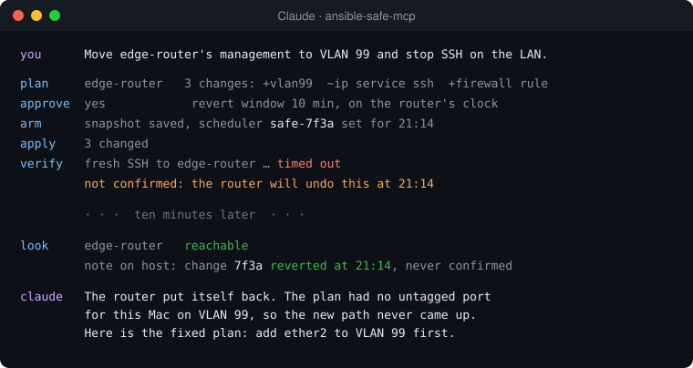
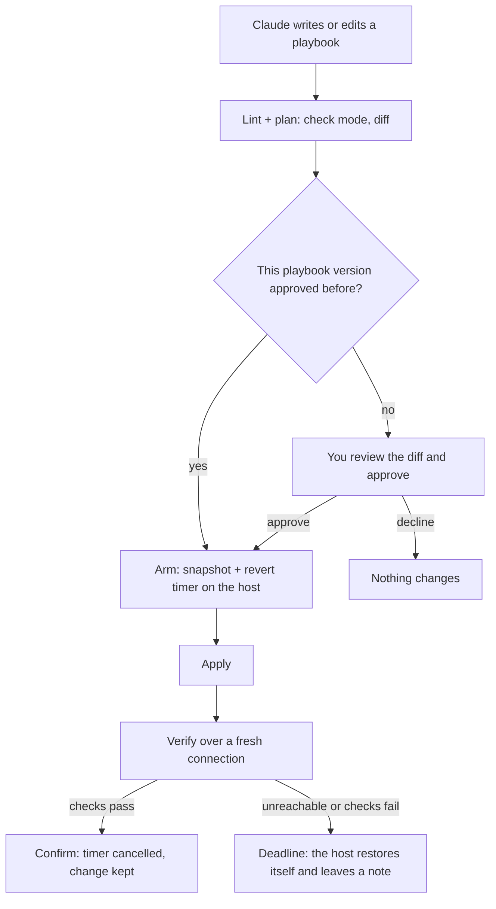

<div align="center">

# Ansible Safe MCP

**Run Ansible from Claude. Every change undoes itself unless it's confirmed.**


[](LICENSE)

<p></p>

Claude writes the playbook, shows you the diff, and runs it under a timer that lives **on the host**.<br>
If Claude can still reach the host afterwards, the change is kept. If it can't, the host puts itself back.

</div>

> [!NOTE]
> **Design preview.** This README is written first, before the code, to check that the idea holds. Nothing is
> released yet. The [roadmap](#roadmap) says what comes in which order.

---

## Why this exists

Ansible is how most people already change their servers, routers and laptops, and Claude is good at writing
playbooks. What stops people from letting the two meet is one fear: *the agent changes something, loses the
connection, and nobody can get back in.*

Ansible's own answer is `block`/`rescue`, and it can't help in exactly that case. A rescue runs **on the
controller**. When the change cut the controller off from the host, there is nobody left to run it. Network
engineers solved this decades ago with *commit confirmed*: the device applies the change, starts a timer, and rolls
back on its own unless someone reconnects and confirms. Junos has it, Cisco has a revert timer, OpenWrt's LuCI uses it
on every Save & Apply. Linux, Windows and macOS don't have it at all.

This project brings commit-confirmed to everything Ansible manages, and gives Claude an MCP server built around it:

1. **Look** freely. Reads run as an unprivileged account that can't change the system.
2. **Plan** freely. `--check --diff` shows exactly what would change.
3. **Change** with your yes (once per playbook version), under a timer on the host. Kept only after Claude proves,
   over a brand-new connection, that the host still answers and still works.

## How a change runs



The timer runs on the target, against the target's own clock. If Claude's session ends, your laptop sleeps, or the
change kills SSH, the host still undoes the change. Arming is checked before anything is applied: no armed timer, no
change.

| Host | Timer | Snapshot | On expiry |
|---|---|---|---|
| Linux | `systemd-run` timer, plus a boot check for pending deadlines | files the plan touches, firewall ruleset, unit states | restore, reload, restart units |
| Windows | one-time scheduled task as SYSTEM | registry keys, files, firewall export, service config | import, restore, restart services |
| macOS | LaunchDaemon that rereads its deadline at boot | files, `defaults export`, `pf` rules | restore, restart services |
| MikroTik RouterOS | `/system scheduler` on the router's clock | `/export` and binary backup | inverse script; binary backup as last resort |
| OpenWrt | native: rpcd `uci apply` with rollback | rpcd's own, plus a `sysupgrade -b` archive for non-UCI files | rpcd restores |

## What it looks like

**A routine change**

> **You:** Updates are pending on the web servers. Patch them, one at a time.
>
> **Claude:** *(plan)* 2 hosts, 14 packages, kernel unchanged, no reboot needed. `updates.yml` is the version you
> approved last month, so this runs without asking.
>
> **Claude:** web-1: armed (10 min), applied, nginx and the app answer over a fresh connection, confirmed.
> web-2: same, confirmed. Both done; nothing left pending.

**A change that would have locked you out**

> **You:** Move the router's management to VLAN 99 and stop SSH on the LAN.
>
> **Claude:** *(plan)* 3 changes on edge-router. Approve? → applied under a 10-minute window → a fresh SSH
> connection times out, so I can't confirm. The router will undo this at 21:14.
>
> *(ten minutes later)* edge-router is reachable again and reports change `7f3a` reverted at 21:14. The plan had no
> untagged port for this Mac on VLAN 99. Here is the fixed plan.

**Remote hands, for the one-off job**

> **You:** The NAS ran out of space. Find what grew and clear the Docker build cache.
>
> **Claude:** *(looks)* `/var/lib/docker` grew 61 GB this week, almost all build cache. The fix is one command. I'll
> wrap it as a guarded one-off (cache only, images untouched) and save it to `oneoffs/` so next time it's a playbook.

## Tools

| Tool | Does | Asks you? |
|---|---|---|
| `hosts` | List, add, test and remove hosts. Adding pins the host key, finds the OS and checks both accounts (look, change). | adding a host |
| `look` | Read state: shipped reads (services, containers, logs, disk, updates, router status, interfaces) or a one-off read command, run as the unprivileged look account. | no |
| `playbook` | Create, edit and list playbooks in the project folder (a git repo). Lint runs on every save. | no |
| `plan` | `--check --diff` for a playbook and a host list: what would change, per host. | no |
| `apply` | Run a playbook for real, under the guard: arm, apply, verify over a fresh connection, confirm or let it revert. | **once per playbook version** |
| `hands` | A one-off change ("remote hands"): Claude's steps become a generated playbook under the same guard, saved to `oneoffs/`. | **yes, each time** |
| `job` | Follow a running change; extend its window; confirm or revert it now. | reverting a confirmed change |
| `status` | Pending windows, recent reverts, what the lint guard refused, and the audit log. | no |

## Safety model

| Risk | What stops it |
|---|---|
| A change locks you out | The on-host revert timer. Confirmation needs a **new** connection, not a reused one: Ansible keeps SSH connections open, and an old connection can survive a firewall change that blocks every new one. |
| Claude changes things you didn't approve | Two accounts per host. `look` uses one that can't change the system: on Linux and macOS no sudo beyond a short list of read commands, and not in the `docker` group (Docker's socket is root in disguise); a read-only group on RouterOS. Only `apply` and `hands` use the change account, and only with your yes. |
| Approving so often you stop reading | You approve a **playbook version**, not a run: the hash of the playbook, its roles, vars and targets. An unchanged playbook reruns without asking; any change to it asks again, showing the diff. Playbooks declare their parameters (`name: string`, `hosts: [web]`), so "add a VPN user called X" is approved once, not once per user. |
| A playbook runs code on **your** Mac | Playbooks run on the hosts, but some constructs run on the machine running Ansible: `delegate_to: localhost`, `local_action`, `connection: local`, `lookup('pipe')`, plugins in the project folder, inventory scripts. The lint guard refuses them in anything Claude wrote. Next: every run inside a macOS sandbox as well. |
| A "dry run" that isn't one | `check_mode: false` makes a task run for real in check mode. The lint guard refuses it, so `plan` stays a plan. |
| A playbook disables the guard | Lint refuses changes to the guard's own timers, tasks and scheduler entries. |
| Nobody notices a revert | The revert writes a note on the host. The next `look` or `status` reports it. |
| Your keys | The server uses your SSH agent and never reads `~/.ssh` itself. |
| Who did what | Every call is in an append-only, hash-chained audit log. |

**What a revert can't undo:** deleted data, calls to outside services (an API, a DNS provider, a payment), and package
downgrades (new packages can be removed; an old version usually can't be restored cleanly). Back up data you can't
lose before a change that touches it; the plan says when a playbook does.

## Why not the standard options

| Option | Why it isn't this |
|---|---|
| **Red Hat's Ansible Automation Platform MCP server** | Needs Ansible Automation Platform (a paid enterprise platform). If you run it, use that. |
| **Red Hat's Ansible development tools MCP server** (in the VS Code extension) | For writing playbooks: lint, scaffold, docs. No rollback, no host management, no approval model. A good companion to this one. |
| **Community `ansible-mcp` servers** | Thin wrappers around `ansible-playbook`. They either never ask or ask about everything, have no rollback, and run whatever playbook Claude wrote, including the parts that execute on your Mac. |
| **Claude Code on the server** | One host at a time, Linux or macOS only, no routers, and no undo when the change cuts its own connection. |
| **Plain Ansible with `block`/`rescue`** | The rescue runs on the controller. If the change cut the controller off, it never runs. |

## The collection: rollback for any Ansible user

The timers are a normal Ansible collection, published on Galaxy as `mureev.confirmed`. It works in any playbook,
with or without Claude:

```yaml
- hosts: edge-router
  tasks:
    - mureev.confirmed.arm:
        window: 10m
    - community.routeros.command:
        commands: [/ip service set ssh address=10.99.0.0/24]
    - mureev.confirmed.confirm:
        checks: [ssh, ping]        # over a fresh connection; if they fail, the timer stays armed
```

## Install

Not yet released. It will need Python 3.10+, `ansible-core` 2.17+ (`pipx install ansible-core`) on the Mac, and SSH
access to your hosts with two accounts each. The installer will set up the Claude desktop entry the same way
[mac-terminal-mcp](https://github.com/mureev/mac-terminal-mcp) does.

## Roadmap

| Version | Adds |
|---|---|
| **0.1** | The collection for Linux and RouterOS; the MCP server with `hosts`, `look`, `playbook`, `plan`, `apply`, `job`, `status`; approval once per playbook version, with declared parameters; lint guard; audit log |
| 0.2 | Windows and OpenWrt; `hands` (one-off changes) |
| 0.3 | macOS hosts |
| 0.4 | Every run inside a macOS sandbox (the [mac-terminal](https://github.com/mureev/mac-terminal-mcp) fence); Touch ID approvals |

## License

MIT. Ansible® is a registered trademark of Red Hat, Inc. This project is not affiliated with or endorsed by Red Hat.
