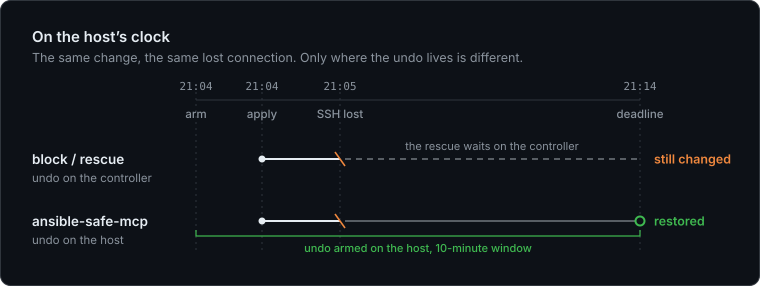
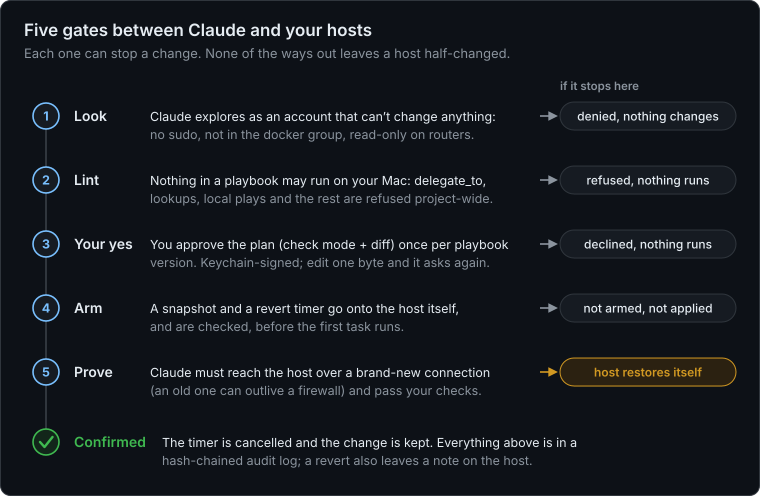

<div align="center">

# Ansible Safe MCP

**Run Ansible from Claude. Every change undoes itself unless it's confirmed.**


[](https://galaxy.ansible.com/ui/repo/published/mureev/confirmed/)
[](LICENSE)



Claude writes the playbook, shows you the diff, and runs it under a timer that lives on the host.<br>
To install it, give your agent this link:

```
https://github.com/mureev/ansible-safe-mcp
```

</div>

---

## Why it's safe

The fear that stops people from letting an agent near their servers is specific: *it changes something, loses the
connection, and nobody can get back in.* Ansible's own safety net can't catch that, because the rescue runs on the
machine that just lost the connection. Network gear solved this long ago with *commit confirmed*: apply, start a
timer on the device, and roll back unless someone reconnects and says "keep it". This brings that to every host
Ansible can reach (Linux: a systemd timer; Windows: a SYSTEM task; macOS: a LaunchDaemon; RouterOS: Safe Mode;
OpenWrt: a timer in RAM), and puts four more gates in front of it:



**What a revert can't undo:** deleted data, calls to outside services, and package downgrades. The plan says when a
playbook touches those.

## Is it for you?

You run a few servers, routers or PCs over SSH and want Claude to do the chores: patch, fix, look into why the disk
filled up. It works on **Linux, Windows, macOS, MikroTik RouterOS and OpenWrt**, directly or through a jump host,
from the Claude desktop app on a Mac. If you have Ansible Automation Platform, Red Hat's own MCP server fits better
([the other options](AGENTS.md#why-not-the-standard-options)).

The timers also work without Claude: [`mureev.confirmed`](https://galaxy.ansible.com/ui/repo/published/mureev/confirmed/)
is a plain Ansible collection on Galaxy.

## For agents

Everything an agent needs, to install it and then to use it, is in **[AGENTS.md](AGENTS.md)**. Read it before installing.

## License

MIT. Ansible® is a registered trademark of Red Hat, Inc. This project is not affiliated with or endorsed by Red Hat.
