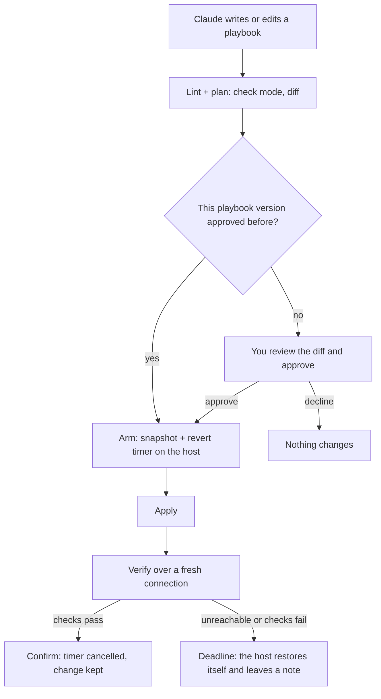

<div align="center">

# Ansible Safe MCP

**Run Ansible from Claude. Every change undoes itself unless it's confirmed.**


[](LICENSE)

<p></p>

Claude writes the playbook, shows you the diff, and runs it under a timer that lives **on the host**.<br>
If Claude can still reach the host afterwards, the change is kept. If it can't, the host puts itself back.

</div>

> [!NOTE]
> **0.1 preview.** Changes are guarded on **Linux** hosts and **MikroTik RouterOS** (Safe Mode). Tested end
> to end against a real SSH server, including a change that locks Ansible out and a host that puts itself back
> ([tests](#tests)). Not yet on Galaxy or in the MCP directories. The [roadmap](#roadmap) says what comes next.

---

## Why this exists

Ansible is how most people already change their servers, routers and laptops, and Claude is good at writing
playbooks. What stops people from letting the two meet is one fear: *the agent changes something, loses the
connection, and nobody can get back in.*

Ansible's own answer is `block`/`rescue`, and it can't help in exactly that case. A rescue runs **on the
controller**. When the change cut the controller off from the host, there is nobody left to run it. Network
engineers solved this decades ago with *commit confirmed*: the device applies the change, starts a timer, and rolls
back on its own unless someone reconnects and confirms. Junos has it, Cisco has a revert timer, OpenWrt's LuCI uses it
on every Save & Apply. Linux, Windows and macOS don't have it at all.

This project brings commit-confirmed to everything Ansible manages, and gives Claude an MCP server built around it:

1. **Look** freely. Reads run as an unprivileged account that can't change the system.
2. **Plan** freely. `--check --diff` shows exactly what would change.
3. **Change** with your yes (once per playbook version), under a timer on the host. Kept only after Claude proves,
   over a brand-new connection, that the host still answers and still works.

## How a change runs



The timer runs on the target, against the target's own clock. If Claude's session ends, your laptop sleeps, or the
change kills SSH, the host still undoes the change. Arming is checked before anything is applied: no armed timer, no
change.

| Host | Timer | Snapshot | On expiry |
|---|---|---|---|
| Linux | `systemd-run` timer, plus a boot check for pending deadlines | files the plan touches, firewall ruleset, unit states | restore, reload, restart units |
| Windows | one-time scheduled task as SYSTEM | registry keys, files, firewall export, service config | import, restore, restart services |
| macOS | LaunchDaemon that rereads its deadline at boot | files, `defaults export`, `pf` rules | restore, restart services |
| MikroTik RouterOS | Safe Mode, held by the server for the change (the router undoes it if the session ends abnormally) | the router's own Safe Mode history | Ctrl+D; or the router itself when the session drops |
| OpenWrt | native: rpcd `uci apply` with rollback | rpcd's own, plus a `sysupgrade -b` archive for non-UCI files | rpcd restores |

## What it looks like

**A routine change**

> **You:** Updates are pending on the web servers. Patch them, one at a time.
>
> **Claude:** *(plan)* 2 hosts, 14 packages, kernel unchanged, no reboot needed. `updates.yml` is the version you
> approved last month, so this runs without asking.
>
> **Claude:** web-1: armed (10 min), applied, nginx and the app answer over a fresh connection, confirmed.
> web-2: same, confirmed. Both done; nothing left pending.

**A change that would have locked you out**

> **You:** Move the router's management to VLAN 99 and stop SSH on the LAN.
>
> **Claude:** *(plan)* 3 changes on edge-router. Approve? → applied under a 10-minute window → a fresh SSH
> connection times out, so I can't confirm. The router will undo this at 21:14.
>
> *(ten minutes later)* edge-router is reachable again and reports change `7f3a` reverted at 21:14. The plan had no
> untagged port for this Mac on VLAN 99. Here is the fixed plan.

**Remote hands, for the one-off job**

> **You:** The NAS ran out of space. Find what grew and clear the Docker build cache.
>
> **Claude:** *(looks)* `/var/lib/docker` grew 61 GB this week, almost all build cache. The fix is one command. I'll
> wrap it as a guarded one-off (cache only, images untouched) and save it to `oneoffs/` so next time it's a playbook.

## Tools

| Tool | Does | Asks you? |
|---|---|---|
| `hosts` | List, add, test and remove hosts. Adding connects once, shows you the host key's fingerprint, pins it, and checks both accounts (look, change). | adding a host |
| `look` | Read state: shipped reads (services, containers, logs, disk, updates, router status, interfaces) or a one-off read command, run as the unprivileged look account. | no |
| `playbook` | Create, edit and list playbooks in the project folder (a git repo). Lint runs on every save. | no |
| `plan` | `--check --diff` for a playbook and a host list: what would change, per host. | no |
| `apply` | Run a playbook for real, under the guard: arm, apply, verify over a fresh connection, confirm or let it revert. | **once per playbook version** |
| `hands` *(0.2)* | A one-off change ("remote hands"): Claude's steps become a generated playbook under the same guard, saved to `oneoffs/`. | **yes, each time** |
| `job` | Follow a running change; extend its window; revert it now. | no |
| `status` | Pending windows, recent reverts, what the lint guard refused, and the audit log. | no |

## Safety model

| Risk | What stops it |
|---|---|
| A change locks you out | The on-host revert timer. Confirmation needs a **new** connection, not a reused one: Ansible keeps SSH connections open, and an old connection can survive a firewall change that blocks every new one. |
| Claude changes things you didn't approve | Two accounts per host. `look` uses one that can't change the system: on Linux and macOS no sudo beyond a short list of read commands, and not in the `docker` group (Docker's socket is root in disguise); a read-only group on RouterOS. Only `apply` and `hands` use the change account, and only with your yes. |
| Approving so often you stop reading | You approve a **playbook version**, not a run: the hash of the playbook, the files it can pull in, the roles, and the exact hosts. An unchanged version reruns without asking; any change asks again, with the plan. Playbooks declare their parameters (`asm_params` in the first play's vars), so "add a VPN user called X" is approved once, not once per user. Parameter values are checked against the declaration, may not contain template braces, and reach Ansible marked `!unsafe`, so they are never evaluated. |
| Someone else edits the approvals | Each approval is signed with a key kept in the macOS Keychain, which sandboxed shells can't read. An approval written by anything but this server doesn't verify. |
| Someone else edits the inventory | The server refuses to run if the inventory holds anything its `hosts` tool wouldn't write: a connection variable, group variables, a jump command. |
| A playbook runs code on **your** Mac | Playbooks run on the hosts, but some constructs run on the machine running Ansible: `delegate_to`, `local_action`, `connection: local`, plays on `localhost`, lookups and `with_<lookup>` loops, Jinja `include`/`import` and `__` internals, `src:` paths outside the project, `fetch`, connection and user variables, plugin folders and `ansible.cfg` next to playbooks. The lint guard refuses all of them in the whole project, and plan and apply don't run while anything is refused. The server writes its own `ansible.cfg` (YAML inventory only, no inventory scripts). Next: every run inside a macOS sandbox as well. |
| A "dry run" that isn't one | `check_mode: false` makes a task run for real in check mode. The lint guard refuses it, so `plan` stays a plan. |
| A playbook disables the guard | Lint refuses changes to the guard's own timers, tasks and scheduler entries. |
| Nobody notices a revert | The revert writes a note on the host. The next `look` or `status` reports it. |
| Your keys | The server uses your SSH agent and never reads `~/.ssh` itself. |
| Who did what | Every call is in an append-only, hash-chained audit log. |

**What a revert can't undo:** deleted data, calls to outside services (an API, a DNS provider, a payment), and package
downgrades (new packages can be removed; an old version usually can't be restored cleanly). Back up data you can't
lose before a change that touches it; the plan says when a playbook does.

## Why not the standard options

| Option | Why it isn't this |
|---|---|
| **Red Hat's Ansible Automation Platform MCP server** | Needs Ansible Automation Platform (a paid enterprise platform). If you run it, use that. |
| **Red Hat's Ansible development tools MCP server** (in the VS Code extension) | For writing playbooks: lint, scaffold, docs. No rollback, no host management, no approval model. A good companion to this one. |
| **Community `ansible-mcp` servers** | Thin wrappers around `ansible-playbook`. They either never ask or ask about everything, have no rollback, and run whatever playbook Claude wrote, including the parts that execute on your Mac. |
| **Claude Code on the server** | One host at a time, Linux or macOS only, no routers, and no undo when the change cuts its own connection. |
| **Plain Ansible with `block`/`rescue`** | The rescue runs on the controller. If the change cut the controller off, it never runs. |

## The collection: rollback for any Ansible user

The timers are a normal Ansible collection, `mureev.confirmed` (in [`collections/`](collections/ansible_collections/mureev/confirmed);
on Galaxy from 0.2). It works in any playbook, with or without Claude:

```yaml
- hosts: web
  become: true
  tasks:
    - mureev.confirmed.arm:
        window: 10m
        paths: [/etc/ssh/sshd_config.d/50-hardening.conf]
        services: [ssh]
    - ansible.builtin.copy:
        src: 50-hardening.conf
        dest: /etc/ssh/sshd_config.d/50-hardening.conf
    - ansible.builtin.service: {name: ssh, state: reloaded}
    - mureev.confirmed.confirm:
        checks: [ssh, service:nginx]   # over a fresh connection; a failed check reverts at once
```

## Install

**Requirements:** macOS with the Claude desktop app; Python 3.10+ (`brew install python@3.12`: macOS's own is 3.9);
SSH access to each host with two accounts: one that can only read (no sudo, not in the `docker` group) and one with
passwordless sudo, both accepting a key from your ssh-agent.

Run this in Terminal (it quits Claude while it edits Claude's config, then reopens it):

```
[ -d ~/ansible-safe-mcp ] || git clone https://github.com/mureev/ansible-safe-mcp ~/ansible-safe-mcp
bash ~/ansible-safe-mcp/install.sh
```

It makes a venv with `ansible-core` at `~/.config/claude-mcp/ansible-safe-mcp/venv`, installs a read-only copy of the
server and the collection next to it, checks the copy answers the MCP handshake, backs up
`claude_desktop_config.json` and adds only the `ansible-safe` entry. `--check` shows what is installed and changes
nothing; `--remove` takes the entry and the copy out. Your playbooks live in `~/ansible-safe` (a git repo: every file
Claude writes is a commit); state, approvals and the audit log in `~/.local/state/ansible-safe-mcp`.

**Local Network:** macOS asks before a new program may reach devices on your LAN. Allow "Python" when it asks
(or in System Settings → Privacy & Security → Local Network); until then LAN hosts fail with "No route to host".

If you also use [mac-terminal-mcp](https://github.com/mureev/mac-terminal-mcp), add
`~/.local/state/ansible-safe-mcp` to its `deny_paths`, so a sandboxed shell can't touch this server's state.

**Other MCP clients:** run `server/ansible_safe_mcp.py` with a Python that has `ansible-core`, with `ASM_PROJECT`,
`ASM_COLLECTIONS` (this repo's `collections/`) and, off macOS, `ASM_APPROVER` (a command that gets the request as
JSON on stdin and approves by exiting 0).

## Tests

- `collections/ansible_collections/mureev/confirmed/tests/e2e/`: the collection against a real SSH host: a confirmed
  change stays; a failed check reverts at once; a second arm is refused; and a `DenyUsers` change that locks Ansible
  out is put back by the host at the deadline.
- `tests/e2e_server.py`: the MCP server over stdio, 36 checks: adding a host, reads as the look account (not
  templated, no sudo), every lint refusal, plan, approve once, rerun without asking, edited playbook asks again,
  decline, a half-failed change reverted at once, the lockout, a tampered inventory, the audit log's hash chain, and
  RouterOS under Safe Mode against a stand-in console (confirm; a lockout undone through the held session; a bad
  command undoing the whole change).

Both need a disposable host they may break: see [tests/README.md](tests/README.md). `ansible-test sanity` passes on
the collection.

**On real hardware** (November 2026): an Ubuntu server with systemd (a change kept after confirmation; a change left
unconfirmed reverted by the systemd timer on the host) and a MikroTik hAP ax² on RouterOS 7.24.5 (a change confirmed
under Safe Mode; a change with a typo in its second command undone as a whole, the export identical to before).

## Roadmap

| Version | Adds |
|---|---|
| **0.1** ✓ | The collection for Linux; the MCP server with `hosts`, `look`, `playbook`, `plan`, `apply`, `job`, `status`; approval once per playbook version, with declared parameters; lint guard; audit log; RouterOS changes under Safe Mode held by the server |
| 0.2 | Windows and OpenWrt; `hands` (one-off changes); the collection on Galaxy |
| 0.3 | macOS hosts |
| 0.4 | Every run inside a macOS sandbox (the [mac-terminal](https://github.com/mureev/mac-terminal-mcp) fence); Touch ID approvals |

## License

MIT. Ansible® is a registered trademark of Red Hat, Inc. This project is not affiliated with or endorsed by Red Hat.
